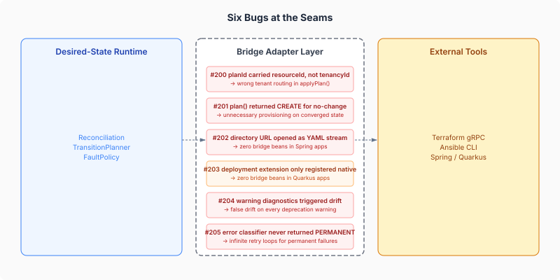
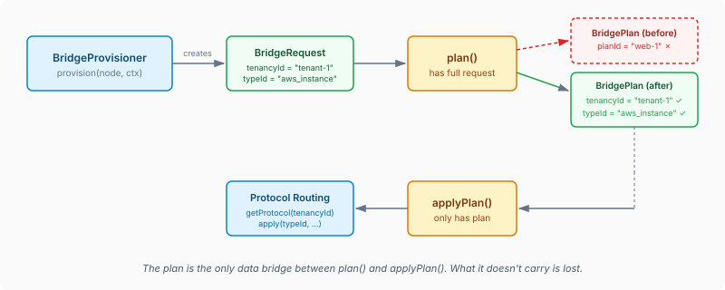

# Six Bugs at the Seams

Bridge adapters are where a desired-state runtime meets the real world. On one side: an abstract reconciliation loop that thinks in graphs, nodes, transitions, and fault policies. On the other side: Terraform's gRPC protocol, Ansible's playbook executor, Spring's classpath scanning, Quarkus's build-time augmentation. Two mental models, connected by a thin layer of translation code.

Every bug we found this week lived in that translation layer. Not in the runtime. Not in Terraform or Ansible. In the bridge — the seam between two systems that each look correct in isolation.

## The Data That Didn't Travel

The first bug was the most instructive. The `PlanCapable` SPI splits provisioning into two phases: `plan()` produces a `BridgePlan`, then `applyPlan()` executes it. The plan is the only data that crosses between the two calls. Whatever the plan doesn't carry is lost.

The Terraform bridge's `plan()` method stored the resource ID (`"web-1"`) as the plan's identifier. Reasonable — you want to know which resource you're planning for. But `applyPlan()` then used that same identifier to look up the tenant's Terraform process and to identify the resource type for the apply call. A resource ID is not a tenant ID. `"web-1"` is not `"tenant-1"`. And it's definitely not `"aws_instance"`.

The fix was structural: add `tenancyId` and `typeId` fields to `BridgePlan` itself. The plan is the contract between plan and apply — it should carry everything apply needs, explicitly. A backward-compatible constructor preserves existing callers that don't use the two-phase path.

The Ansible adapter had the same SPI but a different workaround: it smuggled the entire original `BridgeRequest` inside the plan's `rawPlan` field as an `AnsiblePlanContext`. Clever, but opaque. After the `BridgePlan` change, both adapters now carry routing context in the type system rather than in opaque payloads.

## The Silent Lie

Two bugs were about things that looked correct but silently returned wrong answers.

Ansible's `plan()` method mapped check-mode results to change actions: if Ansible reported `changed: true`, emit `ChangeAction.UPDATE`. If `changed: false`, emit `ChangeAction.CREATE`. Wait — if nothing changed, why signal a creation? The ternary was backwards in its semantics. When check mode reports no changes, the right answer is no `ResourceChange` entries at all. The resource already matches desired state. An empty changes list says "nothing to do," which is exactly right. There is no `NO_OP` in the enum because the absence of entries is the no-op.

Terraform's `doReadState()` had a similar false positive. It detected drift by checking `!planResp.diagnostics().isEmpty()` — but diagnostics include warnings. A deprecation notice from the AWS provider ("use `ami_id` instead of `ami`"), an optional attribute warning, any diagnostic at all would make the resource look drifted. The reconciliation loop would re-provision resources that were perfectly converged.

The fix was one character different: replace `!planResp.diagnostics().isEmpty()` with `hasErrors(planResp.diagnostics())`. The `hasErrors()` method already existed in the same class, filtering for `Severity.ERROR`. The drift detection just wasn't using it.

## The Discovery That Discovered Nothing

The Spring bridge auto-configuration and the Quarkus deployment extension both had discovery failures — different mechanisms, same result: zero bridge beans at startup.

The Spring bug was the subtler one. `BridgeAutoConfiguration.discoverManifests()` called `classLoader.getResources("META-INF/desiredstate/bridges/")` — a directory path. The `URL` you get back from `getResources()` for a directory is a directory URL. Opening a directory URL as an `InputStream` and parsing it as YAML fails. The `catch (Exception e) { // skip malformed manifests }` swallowed the failure. The method returned an empty list. No bridge adapters were created. No error logged. The application started, appeared healthy, and silently did nothing.

Every other Spring auto-config in the project used `PathMatchingResourcePatternResolver` with a glob pattern — `classpath*:META-INF/desiredstate/bridges/*.yaml` — which resolves to individual file URLs. Two lines of pattern-matching infrastructure that the bridge auto-config wasn't using.

The Quarkus deployment extension had a different gap: it only registered native-image resources. The `@BuildStep` that discovers manifests, parses them, and wires them as synthetic CDI beans didn't exist. We added it — following the pattern from `YamlPluginProcessor` with directory and JAR scanning, a `BridgeRecorder` for RUNTIME_INIT bean creation, and `SyntheticBeanBuildItem` registration.

## The Retry Loop That Never Stopped

`AnsibleErrorClassifier.classify()` decides whether a failure is retryable. The reconciliation loop uses this classification to decide whether to try again. The classifier had paths to `TRANSIENT`, `AUTHENTICATION`, `CONFIGURATION`, and `QUOTA` — but no path returned `PERMANENT`.

"Resource already exists." Classified as TRANSIENT. Retry. "Resource already exists." Retry. "Conflict: resource in use." Retry. "Operation not supported on this instance type." Retry. Every genuinely permanent failure was treated as a temporary hiccup. The reconciliation loop would eventually hit its fault threshold, escalate, and create a review node — but only after burning through retries on an error that was never going to resolve itself.

The fix added keyword matching for permanent patterns: `already exists`, `conflict`, `not supported`, `incompatible`, `invalid`, `not found`. These errors describe states that won't change on retry.

## What Seam Bugs Have in Common

All six bugs share a pattern: each side of the seam was correct in isolation. The runtime correctly called `applyPlan()` with the plan it received. Terraform correctly applied the type it was given. The classifier correctly returned the category it computed. Spring correctly opened the URL it discovered.

The bugs lived in the assumptions that crossed the boundary:

- **"The plan carries what apply needs"** — it didn't. The plan carried a resource ID where apply expected a tenant ID.
- **"No changes means CREATE"** — it doesn't. No changes means nothing. The absence of change actions is the signal.
- **"A directory URL is readable as a file"** — it isn't. Directories don't have content.
- **"Warnings mean something changed"** — they don't. Deprecation notices are metadata, not drift.
- **"Everything retryable is TRANSIENT"** — not everything. "Already exists" isn't going to un-exist on retry.

Each assumption was reasonable on the side that made it and wrong on the side that consumed it. This is why integration testing catches what unit tests miss — and why the most dangerous code in a system is often the thinnest layer.

Bridge adapters are glue code. They rarely get the architectural attention of the runtime engine or the provisioner implementations they connect. But every resource state decision — converged, drifted, faulted, retried — flows through them. When the bridge lies, the reconciliation loop believes it.
