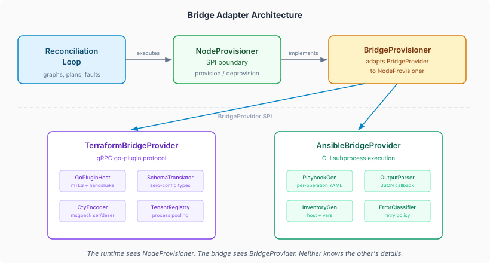
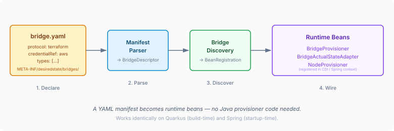

# The Bridge Between Graphs and Infrastructure

A desired-state runtime thinks in abstractions. Graphs. Nodes. Dependencies. Transitions. It knows that node A depends on node B, that A is drifted, and that the fault policy says to retry twice before escalating. What it does not know — and must never know — is that A is an EC2 instance managed by a Terraform provider over gRPC, or a load balancer provisioned by an Ansible collection module.

That boundary is the bridge adapter layer.

## The Problem with Writing Provisioners

The desired-state runtime exposes `NodeProvisioner` as its core SPI for making things happen. Implement `provision()`, `deprovision()`, `readState()`, declare which `NodeType` values you handle, and the reconciliation loop does the rest. It works. For Java teams building domain-specific provisioners — a dungeon room, a data pipeline stage, a deployment environment — it's the right abstraction.

But infrastructure management is different. The provisioner for an AWS security group and the provisioner for a GCP Cloud SQL instance have almost identical structure: read a spec, call an external API, map the response to a status. The differences are in protocol (REST, gRPC, CLI), credential management (IAM roles, service accounts, vault tokens), and error classification (which failures are transient, which are permanent, which mean your credentials expired). Writing a `NodeProvisioner` for each resource type means duplicating all of that plumbing for every type you want to manage.

Terraform solved this problem a decade ago. Providers implement a standard protocol. The host (Terraform CLI, or in our case, the bridge runtime) handles lifecycle, process management, and credential routing. The provider knows only its own resource types.

Ansible solved it differently — collections of modules that share a CLI execution model, an inventory format, and a callback plugin for structured output. Same pattern, different protocol.

The bridge adapter layer borrows from both approaches.

## Two SPIs, One Boundary

The architecture has two layers with a clean SPI boundary between them.

Above the line: `NodeProvisioner`. The reconciliation loop calls `provision()` and `deprovision()` and gets back `ProvisionResult` and `DeprovisionResult`. It has no idea what happens inside. `BridgeProvisioner` implements this interface — it's the adapter that translates between the runtime's world and the infrastructure world.

Below the line: `BridgeProvider`. This is what adapter authors implement. It's a simpler contract — `provision(BridgeRequest)`, `deprovision(BridgeRequest)`, `readState(BridgeRequest)` — without the graph context, the fault policy context, or the approval lifecycle. The bridge runtime handles all of that before the request reaches the provider.

Capability mixins add optional features without complicating the base contract. `PlanCapable` adds a dry-run `plan()` method — the Terraform adapter uses it to call the provider's planning RPC before applying. `ImportCapable` adds `importResource()` for adopting existing cloud resources. `SuspendCapable` adds `suspend()` and `resume()`. A provider implements only what it supports; the bridge runtime detects the capabilities and routes accordingly.

## Zero-Config Discovery

The bridge adapter needs no Java wiring code. A YAML manifest at `META-INF/desiredstate/bridges/` declares the protocol and types. At build time (Quarkus) or startup (Spring), the framework discovers the manifest, parses it into a `BridgeDescriptor`, and registers `NodeProvisioner` and `ActualStateAdapter` beans automatically.

For Terraform, the type discovery goes further. The bridge launches the provider binary, negotiates the go-plugin handshake (protocol v5 or v6, auto-detected), and calls `GetProviderSchema` over gRPC. The response describes every resource type the provider supports — attributes, required fields, computed outputs. `SchemaTranslator` converts this into `DiscoveredType` records with full `PluginSpecSchema` validation. No manifest type list needed. Add a provider binary, and the bridge knows what it can manage.

Ansible takes the opposite path. Modules are self-contained executables; there's no schema discovery protocol. The manifest declares each type explicitly, mapping node types to Ansible module FQCNs for each lifecycle operation. The tradeoff is clear: Terraform's zero-config scales better for providers with many resource types; Ansible's explicit declaration is more predictable and easier to debug.

## Why This Matters

The bridge layer lets the desired-state runtime manage infrastructure resources with the same graph-based reconciliation, fault escalation, and drift detection that it uses for everything else. A Terraform-managed RDS instance and a hand-coded Java provisioner for an internal service both appear as nodes in the same graph, with the same dependency edges, the same fault policies, the same approval gates.

This is the point that gets lost in discussions about infrastructure-as-code tools. Terraform is excellent at managing individual resources. Ansible is excellent at configuring hosts. Neither of them models the *relationships between resources* as a first-class concept with typed fault policies, drift exemptions, approval workflows, and situation-driven replanning. Those are reconciliation-loop concerns, and they apply equally whether the underlying resource is managed by Terraform, Ansible, a REST API, or a Java provisioner.

The bridge adapter layer is what makes that composition possible without forcing infrastructure teams to rewrite their Terraform providers or Ansible modules as Java code. The provider binary stays exactly as HashiCorp or the module author shipped it. The bridge handles the translation. The reconciliation loop handles the intelligence.

We've hardened the layer over the past week — six bugs at the integration seams, a Quarkus deployment extension, Spring classpath discovery fixes. The kind of work that isn't architecturally interesting but is the difference between a design and a system that runs. The bridge documentation now covers the manifest format, the BridgeProvider SPI, the Ansible and Terraform adapters, and a contributor guide for implementing new adapters with the testing TCK.

The infrastructure world already has good tools for provisioning individual resources. What it lacks is the graph that connects them and the runtime that keeps them converged. That's the gap this layer fills.
