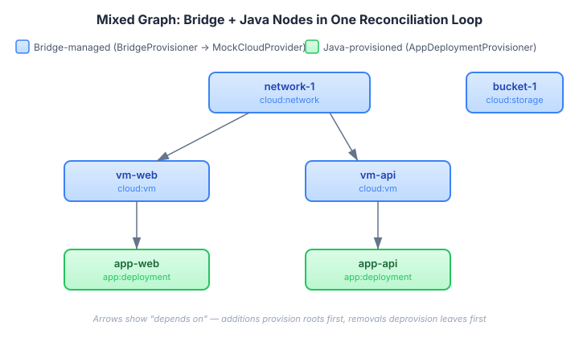
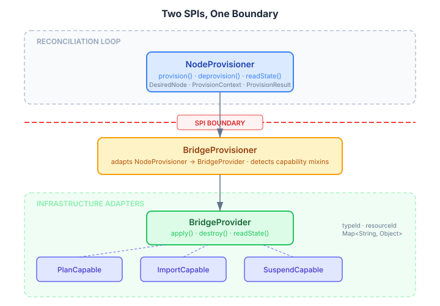

# The Example That Proves the SPI

Continues from [The Bridge Between Graphs and Infrastructure](2026-11-01-mdp02-the-bridge-between-graphs-and-infrastructure.md).

The bridge adapter layer has eight modules, two production adapters, a testing TCK, and a sixty-page architecture chapter. What it didn't have, until today, was a teaching example.

Every other SPI surface in this runtime has one. The dungeon example validates the core SPIs. The pipeline example validates three-tier fault escalation. The expansion example validates lifecycle phases. The pipeline-annotated, pipeline-yaml, and pipeline-ts examples validate the declaration surfaces. Each example exists not because the architecture needs it, but because the documentation needs it. An SPI contract that has never been implemented outside its own module is untested prose.

## What the Example Proves

The bridge-cloud example is a mock cloud-infrastructure domain. `MockCloudProvider` implements `BridgeProvider`, `PlanCapable`, and `ImportCapable` with in-memory state — no real infrastructure, no external processes. Three resource types: VMs, networks, storage buckets. The provider stores resources in a `ConcurrentHashMap`, computes plan diffs by comparing spec fields, and imports by looking up existing entries.

The interesting part isn't the mock. It's the graph.

`CloudGoalCompiler` produces a mixed graph where bridge-managed nodes and Java-provisioned nodes coexist with typed dependencies between them. Networks are roots. VMs depend on networks. Application deployments depend on VMs. Storage is independent. The first three types are `BridgeNodeSpec` instances — opaque `Map<String, Object>` payloads routed to `BridgeProvisioner`. The application deployment type is `AppDeploymentSpec` — a typed Java record routed to `AppDeploymentProvisioner`.

The reconciliation loop handles both. The `DefaultNodeProvisionerRouter` dispatches provision calls by `NodeType` — it doesn't know or care whether the provisioner behind a type is a bridge adapter or hand-written Java. The transition planner respects dependency ordering across both: network provisions first (root, bridge-managed), then VMs (bridge-managed, depend on network), then app deployments (Java-provisioned, depend on VMs). Removals reverse the order.

This is the claim the bridge architecture makes: infrastructure nodes and application nodes compose in the same graph with the same ordering guarantees, the same fault policies, the same drift detection. The teaching example is the proof.

## The Two-SPI Boundary

The architecture has a clean SPI boundary between two layers. Above the line, `NodeProvisioner` speaks the runtime's language — `DesiredNode`, `ProvisionContext`, `ProvisionResult`. Below the line, `BridgeProvider` speaks infrastructure — `typeId`, `resourceId`, `Map<String, Object>`. `BridgeProvisioner` sits on the boundary and translates.

Capability mixins extend the base contract without forcing all adapters to implement everything. `PlanCapable` adds dry-run planning — the Terraform adapter uses it to preview infrastructure changes before applying. `ImportCapable` adds resource adoption — importing existing cloud resources into management without reprovisioning them. `SuspendCapable` adds pause/resume. A provider implements only what it supports. `BridgeProvisioner` detects the capabilities via `instanceof` at construction time and routes accordingly.

The teaching example implements `PlanCapable` and `ImportCapable`. The TCK contract tests validate the contracts: `BridgeProviderContractTest` covers the core lifecycle (apply, destroy, readState, idempotency), `PlanCapableContractTest` covers plan-then-apply, `ImportCapableContractTest` covers resource import. Fourteen tests against the mock provider, using the same abstract test classes that validate the production Terraform and Ansible adapters.

## Living Architecture

I also wrote the ARC42Stories chapter for the bridge layer. Chapter 11 (Bridge Adapter Architecture) and Layer L10 in the building block view. The chapter documents the two-SPI split, the manifest-driven discovery pipeline, per-tenant process isolation, error classification, framework parity, and the testing TCK — with six gotchas in symptom-cause-fix format from real bugs found during hardening.

ARC42Stories is the project's architecture record. What makes it different from a static architecture document is that it captures architecture in motion — each chapter narrates a capability that was added, what accountability gaps it closed, and what layer impacts it had. The chapter index and layer-chapter matrix show how capabilities compose over time. Layer entries carry the implementation detail: key files, key wiring, architectural decisions, patterns, and gotchas.

The bridge chapter is the eleventh. Looking back across the matrix, the pattern is visible: L1 and L2 (Core API, Runtime Engine) appear in every early chapter because they bear foundational weight. L6 (Domain Examples) has the most "High" entries — each new capability is validated through examples. L10 (Bridge Adapter) appears in exactly one column. It adds eight modules, but touches nothing that existed before. That's the design: bridge adapters integrate with the runtime purely through existing SPIs. No new hooks, no special-case code paths, no runtime modifications. The L10 column having exactly one entry is the architectural signal that the SPI surface was complete before bridges were built.

## What This Opens Up

The teaching example makes the contributor guide's "Implementing a New BridgeProvider" section testable. Before today, that section was directions without a map. Now there's a working reference implementation that new adapter authors can copy, modify, and run — with TCK tests that tell them whether their provider meets the contract before they try it against real infrastructure.

The next issue in the queue adds `SuspendCapable` support to the Terraform and Ansible adapters. The teaching example will get a `SuspendCapable` variant when that lands, completing the full mixin coverage.
