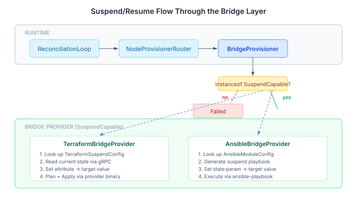
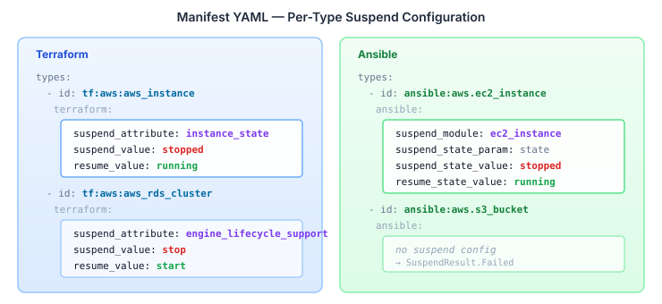

# When Infrastructure Learns to Sleep

Continues from [The Example That Proves the SPI](2026-11-03-mdp01-the-example-that-proves-the-spi.md).

Back in September, we added suspend/resume as a [four-verb lifecycle](2026-09-28-suspend-resume-lifecycle.md) to the core runtime. `NodeProvisioner` gained `suspend()` and `resume()` as opt-in default methods. `TransitionPlanner` learned to emit suspension and resumption steps alongside additions and removals. The reconciliation loop gained a 5×2 decision matrix — actual status crossed with target status — and the entire thing worked end-to-end for Java-implemented provisioners.

But the bridge layer didn't speak that language. `TerraformBridgeProvider` and `AnsibleBridgeProvider` both implemented `BridgeProvider`, `PlanCapable`, and `ImportCapable`. Neither implemented `SuspendCapable`. Every bridge-managed resource was limited to the two-verb lifecycle: create or destroy. If you wanted to stop an EC2 instance without terminating it, you were outside the graph.

## Why Suspend Matters for Infrastructure

The suspend/resume gap isn't academic. Consider a dev/staging environment with a dozen EC2 instances and an RDS cluster. At 6pm, nobody is using them. At 9am, they need to be back. With only provision and deprovision, the choices are wasteful: leave them running overnight (paying for idle compute), or terminate and reprovision them (losing instance store data, IP assignments, warm caches, and database replication state). Suspend is the third option — stop the instances, hibernate the database, pay only for storage, and resume everything intact in the morning.

The desired-state runtime already knows how to express this. A `GoalCompiler` sets `TargetStatus.SUSPENDED` on the nodes at 6pm and `TargetStatus.ACTIVE` at 9am. The transition planner generates suspension steps for the evening and resumption steps for the morning. But the planner can only generate steps for provisioners that support them. Without `SuspendCapable` on the bridge adapters, those steps hit the default implementation — which returns `Failed`.

## The Routing Was Already There

This is the part that validates the original SPI design. `BridgeProvisioner` — the adapter that sits between the runtime's `NodeProvisioner` interface and the bridge's `BridgeProvider` interface — already handles `SuspendCapable`:

```java
@Override
public SuspendResult suspend(DesiredNode node, SuspendContext context) {
    if (provider instanceof SuspendCapable sc) {
        var request = toBridgeRequest(node, context.tenancyId());
        var result = sc.suspend(request);
        return switch (result) {
            case BridgeResult.Success s -> new SuspendResult.Success();
            case BridgeResult.Failed f -> new SuspendResult.Failed(f.reason());
            case BridgeResult.PendingApproval p ->
                new SuspendResult.PendingApproval(node.id(), p.planReference());
        };
    }
    return new SuspendResult.Failed("Provider does not support suspend");
}
```

The `instanceof` check, the request translation, the result mapping — all written when the `SuspendCapable` interface was designed. The mock provider and the TCK contract test existed in `bridge/testing`. The gap was purely in the two production adapters.

## Two Adapters, Two Strategies



The interesting design question was how each adapter maps the abstract concept of "suspend this resource" to its protocol's concrete operations. Terraform and Ansible do this differently because their underlying models are different.

**Terraform** operates on state attributes. Every Terraform resource has a schema, and lifecycle state is an attribute within that schema. Suspending an EC2 instance means setting `instance_state` to `stopped` and applying. Resuming means setting it back to `running`. The adapter reads the current state via gRPC, modifies the target attribute, plans the diff, and applies. The same plan-then-apply path used for provisioning — just with a single attribute override instead of a full spec.

**Ansible** operates on module invocations. Suspending an EC2 instance means calling `amazon.aws.ec2_instance` with `state: stopped`. Resuming means calling it with `state: running`. The adapter generates a playbook with the suspend module and state parameter, then executes it through `ansible-playbook`. The same execution path used for provisioning — just with different module parameters.

The common thread: neither adapter needed new infrastructure. Both reuse their existing execution paths with different inputs. Suspend and resume are not new operations — they're the same operations with different arguments.

## The Manifest Extension Pattern

Both adapters need per-type configuration to know which resources support suspend and how to do it. Not every resource type can be suspended — S3 buckets don't have a stopped state, DNS records don't hibernate. The configuration lives in the bridge manifest YAML, alongside the existing per-type provisioning config.



For Terraform, I chose an attribute triplet: `suspend_attribute`, `suspend_value`, `resume_value`. The adapter looks up the triplet by type ID, overrides the attribute in the current state, and applies. If a type has no triplet, the adapter returns `Failed` with `BridgeErrorCategory.CONFIGURATION`.

For Ansible, the config is richer: `suspend_module`, `suspend_state_param`, `suspend_state_value`, and their resume counterparts. Most Ansible modules use the same module for suspend and resume — `ec2_instance` with `state: stopped` vs `state: running` — so the resume module defaults to the suspend module when unset. Types without a `suspend_module` entry return `Failed`.

The pattern is deliberately parallel between the two adapters despite the different protocol mechanics. Deployers who write bridge manifests for both tools see the same structure: per-type blocks in the manifest, presence means supported, absence means unsupported. No schema-scanning heuristics, no magic detection. If the manifest says a type can be suspended, it can be. If it doesn't, it can't.

## What the Config Tells You About the SPI

The manifest extension pattern reveals something about how the bridge SPI scales. Each new capability — `PlanCapable`, `ImportCapable`, `SuspendCapable` — adds per-type configuration without changing the core adapter structure. The adapter class gains two methods and a config lookup. The manifest parser reads a few more YAML fields. The TCK contract test validates the contract. The runtime routing activates automatically via `instanceof`.

None of this is accidental. The `BridgeProvider` interface was designed as a minimal base contract (apply, destroy, readState) with capability mixins layered on top. Adding a capability to an existing adapter doesn't touch the core provisioning path, doesn't change the constructor of `BridgeProvisioner`, doesn't modify the bridge discovery pipeline. It's additive at every layer.

This is what an SPI should feel like in practice: adding a capability to two production adapters, each backed by a different protocol, with full TCK coverage, takes four commits and changes zero lines outside the bridge modules. The runtime doesn't know. The planner doesn't care. The reconciliation loop generates the right steps because the provisioner router reports the right capabilities.

## What This Opens Up

With both production adapters supporting `SuspendCapable`, the suspend/resume lifecycle works end-to-end for bridge-managed infrastructure. A `GoalCompiler` can produce graphs with `TargetStatus.SUSPENDED` nodes, and the reconciliation loop will generate the correct suspension and resumption transitions for Terraform resources, Ansible-managed resources, and Java-provisioned resources — all in the same graph, with the same dependency ordering, the same fault policies, the same drift detection.

The obvious next use case is scheduled scaling. Dev environments that spin down at night and spin up in the morning. Cost-optimised staging that suspends between CI runs. GPU instances that hibernate between training batches. The runtime already handles the scheduling mechanics via event-driven reconciliation — the bridge adapters now speak the right verbs.
