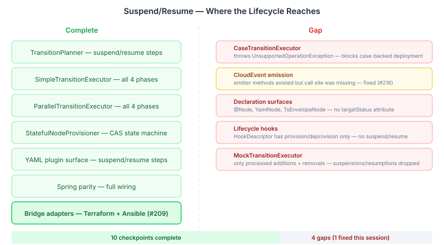

# The Lifecycle That Was Almost Complete

Continues from [When Infrastructure Learns to Sleep](2026-11-04-mdp01-when-infrastructure-learns-to-sleep.md).

After landing `SuspendCapable` on both bridge adapters, I ran an audit. The question was simple: does the suspend/resume lifecycle actually work end-to-end across every surface in the runtime? Not just the happy path through `SimpleTransitionExecutor` — but CloudEvents, declaration surfaces, lifecycle hooks, case-backed execution, Spring parity, the test infrastructure itself.

The answer was: almost. Ten checkpoints passed. Four didn't.

## What "Almost" Looks Like



The core runtime is solid. `TransitionPlanner` generates the right steps. Both sequential executors (`SimpleTransitionExecutor`, `ParallelTransitionExecutor`) handle all four transition phases. `StatefulNodeProvisioner` manages per-node lifecycle state via CAS state machines. The YAML plugin surface has `suspendSteps`/`resumeSteps` sections. Spring wiring has full parity. Persistence round-trips `targetStatus` through `GraphSerializer`. The bridge adapters — as of today — speak the right verbs.

The gaps were in the periphery. Not in the execution path, but in everything that wraps it.

## The Silent Event

The most instructive gap was CloudEvents. `ReconciliationEventEmitter` had `nodeSuspended()` and `nodeResumed()` methods. They were unit-tested. The event type constants (`NODE_SUSPENDED`, `NODE_RESUMED`) were defined in `DesiredStateEventTypes`. The data records (`NodeSuspendedData`, `NodeResumedData`) existed with proper null-checks.

But `ReconciliationLoop` never called them.

The outcome processing loop handled three cases: `Failed` → emit `nodeFaulted`, `Rejected` → emit `nodeFaulted` with `APPROVAL_REJECTED`, `AlreadyConverged` → emit `nodeAlreadyConverged`. The `Succeeded` case? Silent. Successful provisions and deprovisions didn't emit individual events either — they relied on the aggregate `reconciliationCompleted` event at cycle end. But for observability, knowing that a specific node was suspended or resumed matters. Audit trails need it. Downstream automation needs it. Alert suppression for suspended nodes needs it.

The fix was three lines of production code and a `MockTransitionExecutor` fix. The mock only processed `flatRemovals()` and `flatAdditions()` — it silently dropped `flatSuspensions()` and `flatResumptions()`. Suspension steps went into the plan, the mock ignored them, the outcome map came back empty for those nodes, and no events fired. The production executor handled them correctly; the test infrastructure didn't.

This is the pattern that makes lifecycle features hard to complete. The core works. The mock works for the original two verbs. Nobody notices the mock doesn't handle the new verbs because the tests that would catch it don't exist yet — they can't exist until someone writes them, and nobody writes them until someone asks "why isn't this event showing up?"

## The Executor That Said No

`CaseTransitionExecutor` — the engine-adapter path that generates cases with Worker(Workflow) phases for each transition — has four lines that block the entire suspend/resume lifecycle for case-backed deployments:

```java
if (!plan.flatSuspensions().isEmpty() || !plan.flatResumptions().isEmpty()) {
    throw new UnsupportedOperationException(
        "CaseTransitionExecutor does not yet support suspend/resume...");
}
```

This is honest code. It doesn't silently fail or produce wrong results — it tells you it can't do this yet. But it means any deployment that uses `CaseTransitionExecutor` (anything with human-gated nodes requiring casehub-work integration) cannot suspend or resume resources. The two simpler executors handle it fine. The production-grade executor doesn't.

## Surfaces That Can't Express Intent

The three declaration surfaces — annotations (`@Node`), YAML (`YamlNode`), TypeScript DSL (`TsEnvelopeNode`) — have no `targetStatus` attribute. A `GoalCompiler` using any of these surfaces to declare its graph cannot express "this node should be suspended" in the declaration itself. The workaround is programmatic: compile the graph from the declaration, then mutate `targetStatus` on specific nodes after the fact. It works, but it's a two-step dance where a single declaration should suffice.

The same gap appears in lifecycle hooks. `HookDescriptor` has `provisionPre`, `provisionPost`, `deprovisionPre`, `deprovisionPost` — four hooks for two verbs. Suspend and resume get zero. If a deployer wants to drain connections before suspending a node, or warm caches after resuming one, there's no hook point to attach that logic. It has to live inside the provisioner itself, which breaks the separation between "what to do around a lifecycle transition" and "how to execute the transition."

## What the Audit Pattern Reveals

Every gap follows the same shape: the core path was built for provision and deprovision. When suspend and resume were added, the core execution path was updated — planners, executors, provisioner routing. But the surfaces that wrap execution — event emission, declaration, hooks, case generation, test infrastructure — were built for two verbs and not extended to four.

This isn't a design flaw. It's a lifecycle feature characteristic. A new verb doesn't just need an implementation path. It needs to be wired into every surface that the existing verbs touch: every event the system emits, every declaration surface that expresses intent, every hook point that allows customisation, every executor that orchestrates the work, every mock that simulates it. The execution path is maybe 20% of the work. The remaining 80% is making the new verb a first-class citizen everywhere the old verbs already are.

The good news: none of these gaps require architectural changes. The patterns exist — provision hooks, provision events, provision declaration attributes. Each gap is a matter of replicating the existing pattern for two more verbs. Six issues filed, all following established patterns, all independently shippable.

## Where the Adapters Belong

A separate question surfaced during this work: should the Terraform and Ansible bridge adapters live in `desiredstate` or `ops`?

I'd been thinking of them as "reusable protocol adapters" — any domain could use Terraform, so the adapter belongs in the foundation tier. But that argument doesn't survive scrutiny. If the agency domain needs GPU instances, it doesn't import `bridge/terraform` and talk to Terraform directly. It expresses a desired state that includes compute resources, and ops provisions them. Agency never knows Terraform exists. That's the whole point of the layered architecture.

Terraform and Ansible are infrastructure deployment tools. Infrastructure deployment is what ops does. The bridge *SPI* — `BridgeProvider`, `SuspendCapable`, `BridgeProvisioner`, the TCK — stays in desiredstate. It's the generic framework for wrapping any tool. The concrete adapters that know about gRPC go-plugin handshakes and Ansible playbook YAML generation belong with the domain that uses them. That move is tracked but not urgent — the adapters work fine where they are, and the SPI boundary is clean enough that the relocation is mechanical.
