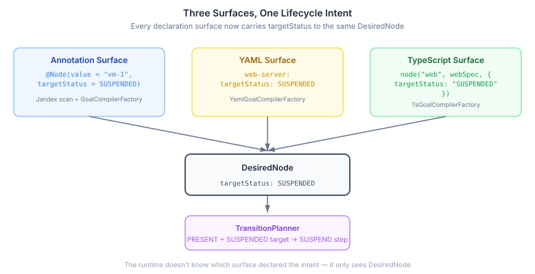
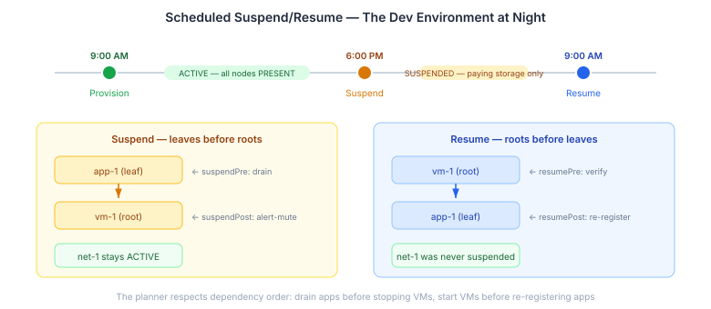
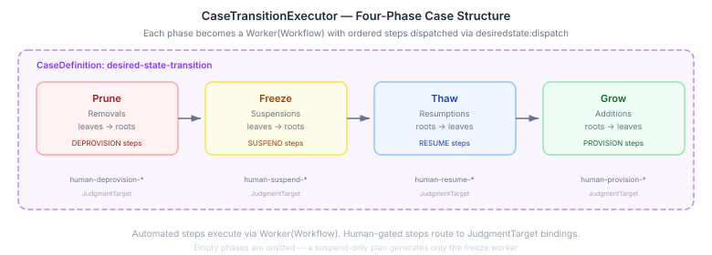
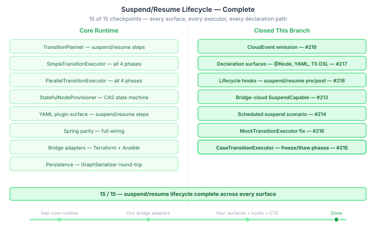

# The Surface Area of Sleep

Continues from [The Lifecycle That Was Almost Complete](2026-11-04-mdp02-the-lifecycle-that-was-almost-complete.md).

The audit left a punch list. Four gaps between "the runtime supports suspend/resume" and "a deployer can actually use it." This is the work that closed all of them. The lifecycle is now 15/15 — every surface, every executor, every declaration path.

## Why Declaration Matters More Than Execution

The runtime has handled `TargetStatus.SUSPENDED` since September. `TransitionPlanner` generates suspension and resumption steps. Both sequential and parallel executors process all four transition phases. The bridge adapters speak `SuspendCapable`. At the execution layer, suspend/resume works.

But execution is not the interface deployers touch. Deployers declare intent. They write `@Node` annotations, YAML graphs, or TypeScript DSL definitions. If none of those surfaces can express "this node should be suspended," the deployer is forced into a two-step pattern: declare the graph, then programmatically mutate target statuses after compilation. That's not declarative — it's declarative with a manual override.

The gap was small in code and large in design integrity. Three surfaces, each with their own parser, scanner, and compilation path, all converging on the same `DesiredNode` record. The fix is mechanical once you know the pattern. The pattern is: `humanGating` already travels this path. `targetStatus` follows the same route.



The annotation surface now carries `targetStatus` from `@Node(targetStatus = SUSPENDED)` through Jandex scan to `GoalCompilerFactory`. The YAML surface carries it from `targetStatus: SUSPENDED` in the node definition through `HookResolver` to `YamlGoalCompilerFactory`. The TypeScript surface carries it from `node("web", spec, { targetStatus: "SUSPENDED" })` through the JSON envelope to `TsGoalCompilerFactory`. All three converge on the 5-arg `DesiredNode` constructor. The runtime doesn't know which surface declared the intent — it only sees the node.

Quarkus bytecode recording was the one wrinkle. Adding a second constructor to `NodeDescriptor.InterfaceNode` (a backward-compatible 4-arg alongside the canonical 5-arg) confused the recorder. Every deployment test failed with `BytecodeRecorderImpl.writeBytecode` errors. The fix was `@RecordableConstructor` on the canonical constructor — explicit disambiguation that the recorder needs when records have multiple constructors. This is the kind of thing you encounter exactly once per Quarkus project, then remember.

## Hooks Around the Transition

Lifecycle hooks existed for provision and deprovision: `HookDescriptor` had four fields — `provisionPre`, `provisionPost`, `deprovisionPre`, `deprovisionPost`. `NodeStepExecutor` ran pre-hooks as fail-fast gates before the provisioner call, and post-hooks as best-effort side-effects after success. The YAML surface exposed them as nested `provision.pre` and `deprovision.post` blocks.

Suspend and resume had none of this. A deployer couldn't say "drain connections before suspending" or "re-register with service discovery after resuming." Those actions had to live inside the provisioner itself, which breaks the separation between lifecycle orchestration (hooks) and transition execution (provisioner).

`HookDescriptor` now has eight fields. `NodeStepExecutor` runs `suspendPre`/`suspendPost` and `resumePre`/`resumePost` with the same semantics: pre-hooks gate, post-hooks log. `YamlNode` carries `suspend` and `resume` hook blocks. `GraphSerializer` round-trips all eight fields through JPA persistence.

The practical use cases are concrete. `suspendPre`: drain connections, flush caches, checkpoint state. `suspendPost`: mute monitoring alerts for this node. `resumePre`: verify disk space and network before starting. `resumePost`: warm caches, re-register with service discovery. These are the actions that make suspend/resume operationally safe rather than just technically possible.

## The Dev Environment at 6pm

The teaching scenario is the proof. `CloudGoalCompiler` in the bridge-cloud example now accepts a `suspendedNodeIds` set in the blueprint. The same blueprint, recompiled with different suspended nodes, produces different target statuses. No new provisioner code. No new SPI implementation. Just the compiler expressing scheduling intent.



The integration test runs three reconciliation cycles: provision everything as ACTIVE, recompile with VMs and apps SUSPENDED, then recompile back to ACTIVE. The planner generates dependency-ordered transitions automatically. Suspend goes leaves-first: drain the app deployment before stopping the VM it runs on. Resume goes roots-first: start the VM before re-registering the app. Both bridge-managed infrastructure nodes and Java-provisioned application nodes participate in the same cycle — the reconciliation loop doesn't care which provisioner type backs each node.

This is the practical scenario the platform enables. A staging environment with a dozen VMs, a database cluster, and application deployments. At 6pm, a scheduler recompiles the desired state with compute nodes suspended. At 9am, it recompiles back to active. The VMs hibernate — paying only for storage overnight. The apps checkpoint state before the underlying VM stops, and warm caches when it resumes. The network stays active throughout because it was never in the suspended set. The deployer expresses all of this in the blueprint, not in imperative scripts.

## The Executor That Learned to Pause

The last gap was `CaseTransitionExecutor` — the engine-adapter module that translates transition plans into casehub-engine `CaseDefinition` structures with Worker(Workflow) phases. It had been explicitly guarded:

```java
if (!plan.flatSuspensions().isEmpty() || !plan.flatResumptions().isEmpty()) {
    throw new UnsupportedOperationException(
        "CaseTransitionExecutor does not yet support suspend/resume...");
}
```

This mattered because any deployment using case-backed execution — which includes anything with human-gated nodes requiring WorkItem integration — couldn't use suspend/resume at all. A staging environment where a manager must approve the 6pm spin-down before it happens? Blocked at the executor.

The fix follows the existing prune/grow pattern. CTE already creates a "prune" Worker for removals and a "grow" Worker for additions, each backed by a generated Serverless Workflow that dispatches step-by-step through `desiredstate:dispatch`. Suspend and resume get the same treatment: a "freeze" Worker for suspensions and a "thaw" Worker for resumptions.



The execution order is prune → freeze → thaw → grow. Remove what's leaving, suspend what's hibernating, wake what's returning, provision what's new. Each phase is a separate Worker with its own Workflow — empty phases are omitted entirely. Human-gated nodes get `JudgmentTarget` bindings instead: `human-suspend-<nodeId>`, `human-resume-<nodeId>`. Approval pre-filtering handles pending and rejected approvals before case construction, same pattern as provision and deprovision.

`DesiredStateDispatch` — the callable that fires when a workflow step executes — gained `executeSuspend()` and `executeResume()` methods, each with the same approval-check and router-delegation pattern as provision and deprovision. The `TransitionWorkflowGenerator` needed no changes at all — it was already action-agnostic, generating step definitions from `OrderedStep` without caring which verb each step carries.

## Why This Pattern Matters Beyond Infrastructure

Suspend/resume is the first lifecycle verb pair added since the original provision/deprovision. The interesting question is not whether it works — it does — but what adding a new verb to a desired-state runtime actually requires.

The core is straightforward: two new methods on `NodeProvisioner`, a decision matrix in `TransitionPlanner`, four-phase execution in the transition executors. That's the part you'd design in an afternoon. The rest is surface area. Three declaration surfaces with independent parsers and compilation paths. A hook system with pre/post semantics for each verb. CloudEvent emission for observability. JPA persistence for graph serialization. Build-time Quarkus extensions with Jandex scanning and bytecode recording. Spring auto-configuration with conditional bean registration. Mock infrastructure for testing. Teaching examples that prove the pattern end-to-end.



The 15-checkpoint audit captures this. Half the checkpoints are core runtime — the half you'd think of when someone says "add suspend/resume support." The other half is the surface area that makes the feature usable by actual deployers, observable by actual operations teams, testable by actual CI pipelines, and composable with actual case management workflows. A feature isn't done when the happy path works. It's done when every surface that knows about lifecycle transitions knows about the new verbs.

This has implications for any system that manages desired state — whether that's infrastructure, application topology, agent sessions, or anything else expressed as a dependency graph with lifecycle intent. The runtime is domain-agnostic. The verbs are universal. The pattern of surface-area completion is the work that makes the difference between a runtime primitive and a deployable feature.
