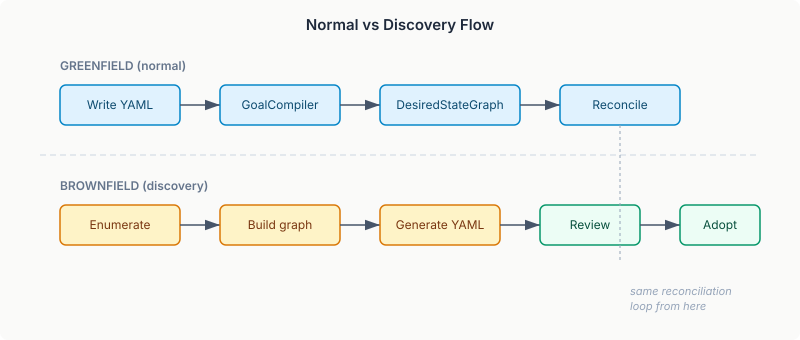
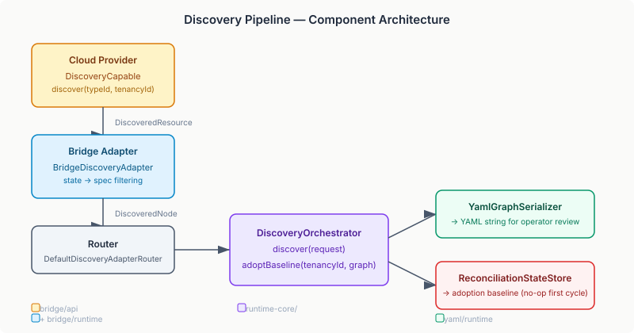

# The Environment That Was Already There

Every desired-state system starts from the same premise: you declare what should exist, and the system makes it so. Write the YAML. Compile the graph. The reconciliation loop provisions, monitors, repairs. It's clean. It's powerful. And it assumes you're starting from nothing.

Most environments aren't nothing.

A staging cluster with thirty EC2 instances, five RDS databases, and a dozen S3 buckets — all provisioned by hand or by Terraform outside the desired-state runtime. The operator wants the reconciliation loop's drift detection, fault escalation, and approval workflows. But to get there, they first need to describe every resource in YAML. Manually. By looking up every instance ID, every configuration parameter, every dependency relationship. For a non-trivial environment, this is a day of work before the system can even start.

The import path (`ImportCapable`) reduced this to writing YAML with `import: "i-abc123"` per resource — the system pulls the current state from the cloud and adopts it. But the operator still needs every resource ID upfront. The list-of-IDs problem remains.

Brownfield discovery inverts the flow.

## The Inversion

In the normal flow, YAML is the input. The operator writes it, the GoalCompiler builds a graph from it, and the reconciliation loop converges actual state toward that graph. Discovery reverses the pipeline: the system enumerates what exists in the cloud, builds a graph from the actual state, serializes it as YAML, and hands it to the operator for review. The operator edits the YAML — removes resources they don't want managed, adds dependencies the system can't infer, adjusts spec fields — and commits it. From that point forward, it's a normal desired-state graph. Same reconciliation loop. Same fault policies. Same drift detection.

The critical step is adoption. When the operator commits the generated YAML and starts the system, the first reconciliation cycle must not provision or deprovision anything. The environment is already running. The system needs to treat the discovered state as the baseline — not as a delta from an empty graph.

We handle this by pre-seeding the `ReconciliationStateStore`. The `TransitionPlanner` compares the desired graph against the last-reconciled graph. If they're identical, it plans zero transitions. Pre-seeding the store with the discovered graph makes the first cycle a no-op. From the second cycle onward, drift detection works normally — any change the operator makes to the YAML, or any change the cloud makes to the infrastructure, appears as a diff and gets reconciled.

## Where Discovery Lives

The architecture follows the same mixin pattern the bridge layer already uses for optional capabilities.

`DiscoveryCapable` is a mixin on `BridgeProvider`, sitting alongside `ImportCapable`, `PlanCapable`, and `SuspendCapable`. A provider implements `discover(typeId, tenancyId)` and returns a list of `DiscoveredResource` records — one per resource found in the cloud for that type. The bridge runtime detects the capability and wires it automatically, same way it wires provisioners and actual-state adapters.

But discovery isn't a bridge-only concern. A CMDB, a Kubernetes API, a monitoring system — any source that knows what exists could feed the pipeline. The runtime layer defines `DiscoveryAdapter` as a general-purpose SPI with the same `handledTypes()` / `discover()` contract. The bridge adapter is one implementation. Others plug in independently.

The `DiscoveryOrchestrator` composes the pieces: it queries the `DiscoveryAdapterRouter` for all registered types, collects the resources, builds a `DesiredStateGraph`, and returns both the raw resources and the graph. YAML serialization is a separate step — the caller passes the resources to `YamlGraphSerializer`, which produces a clean YAML document in the standard desired-state format. The orchestrator doesn't know about YAML. The serializer doesn't know about adapters. Each piece has one job.

## The State-to-Spec Problem

There's a subtlety in the translation from cloud state to YAML spec that's easy to get wrong. Cloud providers return *everything* about a resource: the ID, the creation timestamp, the ARN, the availability zone, computed security group rules. Most of that is read-only — the operator didn't set it and shouldn't manage it. A generated YAML file with every computed field would be noisy, fragile, and confusing.

`DiscoveredNode` carries both: `state` (the full cloud state) and `spec` (the configurable subset). The bridge adapter translates between them, stripping computed fields. What remains in `spec` is what the operator would have written by hand — the name, the instance type, the AMI, the subnet. The YAML serializer writes `spec`, not `state`.

Getting the filter right is provider-specific. Terraform providers expose schema metadata that marks which attributes are computed-only. Ansible modules have a less formal convention but the info-module output structure is consistent enough to parse. The first iteration uses a permissive default — include all state fields — and the bridge manifest gains a `specFields` configuration so operators can tune it per type.

## What This Enables

The practical impact is an adoption path that scales. Instead of days of manual YAML authoring, an operator runs discovery, reviews the output, commits it, and the system adopts the environment in a single cycle. The review step is deliberate — discovery generates a starting point, not a final answer. The operator decides what gets managed.

This also matters for migration. An organisation running Terraform can point the desired-state runtime at their cloud account, discover everything Terraform manages, and have the reconciliation loop take over. The Terraform state isn't needed — the system reads live state from the cloud. If the operator later wants to add fault policies, drift exemptions, or approval gates to specific resources, they edit the YAML. Those are concerns Terraform doesn't model. The desired-state graph does.

The design is deliberately conservative about what it infers. No dependency edges are generated — the operator adds those. No fault policies. No ordering constraints. The generated YAML is a flat list of nodes with their specs. Everything else is a human decision about how the environment should behave, and the system doesn't pretend to know the answer.

Discovery is the front door that the runtime was missing. The reconciliation loop, the fault escalation, the drift detection, the approval workflows — all of that machinery works once the graph exists. Discovery is what gets the graph from reality instead of requiring someone to type it in.
