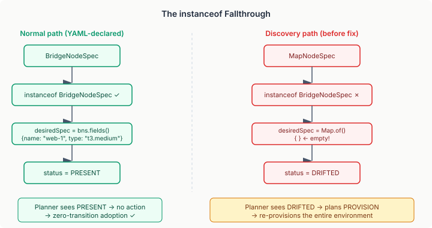

# The instanceof That Swallowed the Spec

The brownfield discovery pipeline looked correct. Five components across four modules, clean SPI boundaries, every unit test green. Discovering 30 EC2 instances, serializing them as YAML, adopting them into the reconciliation loop — the whole flow worked end-to-end in the integration test. Then I looked harder and the whole thing fell apart.

The bug was in `BridgeActualStateAdapter`, a class that had been shipping and working for weeks. One line:

```java
Map<String, Object> desiredSpec = node.spec() instanceof BridgeNodeSpec bns
    ? bns.fields() : Map.of();
```

When the YAML surface creates a node, the spec is a `BridgeNodeSpec`. The `instanceof` check passes. `bns.fields()` returns the configured fields — name, instance type, AMI. The actual-state adapter sends those to the cloud provider as the desired state, the provider compares them to reality, and reports PRESENT or DRIFTED. This has been working fine.

Discovery creates nodes differently. It uses `MapNodeSpec` — a generic `NodeSpec` implementation that carries the same `Map<String, Object>` fields but is a different type. The `instanceof BridgeNodeSpec` check fails. The ternary falls through to `Map.of()`. The adapter sends an empty map as the desired spec.



A Terraform provider receiving an empty desired spec interprets it as "this resource should have no attributes" — which is indistinguishable from "destroy it." The plan response comes back with `requiresReplace = true`. The state mapping translates that to DRIFTED. The transition planner sees DRIFTED and schedules a PROVISION. For every node.

The first reconciliation after brownfield adoption would have re-provisioned the entire environment. The exact opposite of what adoption promises.

## Why the Tests Didn't Catch It

The `MockCloudProvider.readState()` doesn't compare desired spec against actual state. It looks up the resource by ID and returns whatever state it has, regardless of what `desiredSpec` contains:

```java
public BridgeStateResult readState(BridgeReadRequest request) {
    var state = resources.get(key(request.typeId(), request.resourceId()));
    if (state == null) return new BridgeStateResult.NotFound();
    return new BridgeStateResult.Found(Map.copyOf(state));
}
```

The `desiredSpec` parameter is ignored. Whether it contains the full spec or an empty map makes no difference to the mock — it returns PRESENT either way. So every test passes. The unit tests for `BridgeDiscoveryAdapter` verify that `DiscoveredResource` is translated to `DiscoveredNode`. The integration test verifies that `DiscoveryOrchestrator` builds a graph and `YamlGraphSerializer` serializes it. Neither of them runs an actual-state read against a discovered node and checks the result.

The bug lives in the seam between two correct components: the discovery pipeline that produces `MapNodeSpec` nodes, and the actual-state adapter that only extracts fields from `BridgeNodeSpec` nodes. Each component works in isolation. The failure is in their composition.

## The Fix and What It Reveals

The fix is straightforward — handle both spec types:

```java
private Map<String, Object> extractFields(NodeSpec spec) {
    if (spec instanceof BridgeNodeSpec bns) return bns.fields();
    if (spec instanceof MapNodeSpec mns) return mns.fields();
    return Map.of();
}
```

The same pattern appeared in `BridgeProvisioner.toBridgeRequest()` — same `instanceof BridgeNodeSpec` check, same silent fallthrough to empty map. Both classes needed the fix.

What's interesting is the shape of the bug. It's not a logic error — the logic is correct for the type it handles. It's a type coverage gap. Java's `instanceof` pattern matching gives you zero compile-time warning when a new type is introduced that a switch expression or if-chain doesn't handle. `BridgeNodeSpec` was the only `NodeSpec` implementation when this code was written. `MapNodeSpec` is new. Nothing forces the existing code to acknowledge it.

Sealed types would solve this mechanically — if `NodeSpec` were a sealed interface, adding `MapNodeSpec` would require updating every switch that handles it. But `NodeSpec` is an SPI. Sealing it would prevent domain-specific implementations (`DungeonRoomSpec`, `PipelineStageSpec`). The SPI must remain open. The price of openness is that type coverage is a convention, not a compiler guarantee.

## The E2E Test

The test that would have caught this needs to exercise the full composition: discovery produces a node, the actual-state adapter reads it, and the planner decides what to do. Unit testing each piece independently leaves the seam untested.

The `BrownfieldAdoptionE2eTest` does exactly this — seeds four resources into the mock cloud, runs discovery, serializes to YAML, parses the YAML back, builds a desired graph from the parsed nodes (with `MapNodeSpec`, as a real system would), pre-seeds the reconciliation baseline, then runs a full planning cycle and asserts zero transitions. If `desiredSpec` is empty, the mock reports the resource but a drift-aware provider wouldn't — so the test also verifies that `actualStateAdapter.readActual()` returns non-ABSENT, non-UNKNOWN status for every discovered node.

The key assertion:

```java
assertTrue(firstPlan.isEmpty(),
    "First reconciliation plan should be completely empty");
```

This is the brownfield promise. The environment is already running. The first reconciliation sees reality, recognises it matches the declared state, and does nothing. If this assertion fails, the adoption guarantee is broken.

A separate test verifies the fix directly:

```java
DesiredNode node = new DesiredNode(
    NodeId.of("test-vm"),
    new MapNodeSpec(vmType, Map.of("name", "test", "instance_type", "t3.medium")),
    HumanGating.NONE);
DesiredStateGraph graph = graphFactory.of(List.of(node), List.of());

ActualState actual = actualStateAdapter.readActual(graph, "t1");

assertNotEquals(NodeStatus.ABSENT, status,
    "Resource exists in cloud — should not be ABSENT");
```

Before the fix, this test would fail on a drift-aware provider. After the fix, `MapNodeSpec.fields()` is extracted and passed to the provider, just like `BridgeNodeSpec.fields()`.

## The Pattern

Every time a new type enters an SPI that dispatches on `instanceof`, every existing dispatch site is a potential bug. The compiler won't tell you. The unit tests won't tell you — they test the types they were written for. The integration test won't tell you if the mock doesn't exercise the parameter that differs.

The thing that tells you is an end-to-end test that composes the full pipeline with the new type. Not a test of each piece. A test of the composition. The seams are where the bugs live.
