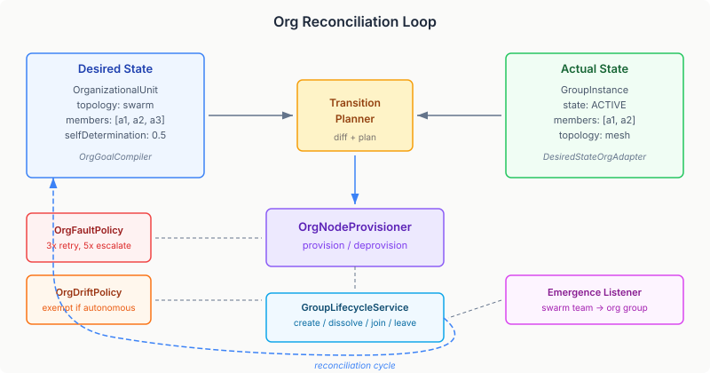
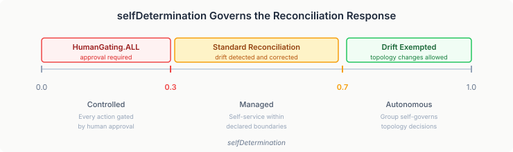
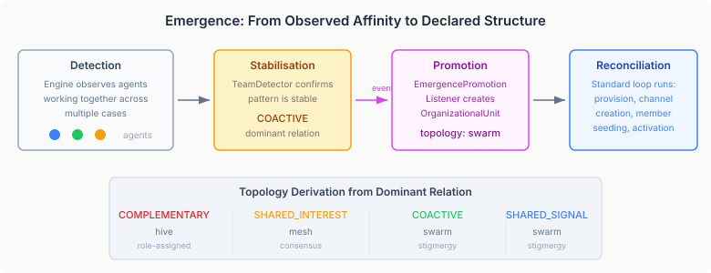
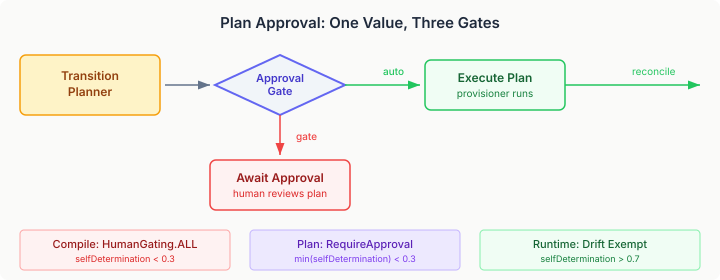

# The Org Chart That Heals Itself

Infrastructure-as-code taught us something that took a decade to absorb: if you declare the desired state and let a reconciliation loop drive convergence, the system heals itself. Nodes crash, networks partition, configurations drift — and the system recovers, because the source of truth is not what *is* running, but what *should be* running.

We applied this to pods. To load balancers. To database replicas. To security groups and DNS records and storage buckets. Every piece of cloud infrastructure learned to describe itself declaratively and heal through a control loop.

We never applied it to teams.

## Organisation as Infrastructure

An agent society has structure. Groups form, adopt coordination topologies, assign roles, take on missions. Members join and leave. Groups that were coordinating via stigmergy signals may stabilise into a supervised hive with a coordinator role. Groups that finish their mission dissolve.

All of this is runtime state that can drift. A member departs and a required role goes unfilled. A group's actual topology diverges from its declared intent. A formation attempt fails repeatedly. In a traditional system, each of these is a special case — a webhook, a notification, a manual remediation workflow. The operations team investigates, then fixes.

In a desired-state system, each of these is just drift. The reconciliation loop detects the gap between what is and what should be, produces a transition plan, and executes it. The same loop. The same planner. The same fault escalation. The same drift policies. The only thing that changes is the domain-specific provisioner and adapter.

That is the insight behind the work that landed today: organisational structure — the groups, relationships, and role assignments that give an agent society its shape — is not a separate concept from infrastructure. It *is* infrastructure. And once you see it that way, the entire desired-state machinery applies without modification.

## What the Bridge Looks Like

The bridge has five components, all implementing existing SPIs. No runtime changes were needed.

**OrgGoalCompiler** takes a list of `OrganizationalUnit` specs and `AgentRelationship` specs and compiles them into a `DesiredStateGraph`. Each unit becomes an `org:unit` node. Each relationship becomes an `org:relationship` node. Parent-child units produce dependency edges (children depend on parents, so parents are provisioned first). The compiler has one new judgment call: when `selfDetermination` is below 0.3, the node gets `HumanGating.ALL` — every lifecycle action requires human approval. This is the declarative equivalent of "this team needs oversight before it can change."

**DesiredStateOrgAdapter** reads the actual state. For each `org:unit` node in the desired graph, it looks up the corresponding `GroupInstance` and maps its lifecycle state to a `NodeStatus`. ACTIVE maps to PRESENT. REORGANISING maps to DRIFTED. Terminal states (DISSOLVED, REJECTED, FAILED) map to ABSENT. For `org:relationship` nodes, it checks the `OrgRegistry` for the relationship's existence. The reconciliation loop now has two snapshots — desired and actual — and can diff them.

**OrgNodeProvisioner** does the actual work when the transition planner produces an addition or removal step. Provisioning an `org:unit` means: register the `OrganizationalUnit` in the `OrgRegistry`, create a `GroupInstance` in ACTIVE state with seeded members, and attempt to create a Qhorus communication channel (best-effort — the channel creator is an injectable SPI with a no-op default). Deprovisioning means: transition the `GroupInstance` to DISSOLVED, remove the unit from the registry, clean up the channel. The provisioner also handles relationship nodes — registering and removing `AgentRelationship` entries.

These three components are the minimum viable bridge. They give the reconciliation loop everything it needs to manage organisational structure. But the interesting work is in the policies.

## Drift That Isn't Drift

Not all drift should be corrected. This is the fundamental insight of drift policy, and it's more nuanced for organisations than for infrastructure.

When a Kubernetes pod's actual configuration diverges from its declared spec, the answer is almost always: reconcile. Force the actual back to the desired. The pod doesn't have opinions about its own configuration. The declaration is authoritative.

Groups are different. A group with high `selfDetermination` — above 0.7 — is expected to make its own structural decisions. When such a group changes its topology from `swarm` to `mesh` because the members determined that consensus-based coordination works better for their current task, that topology change is an *achievement*, not a failure. Correcting it back to `swarm` would fight the system's own adaptive intelligence.

`OrgDriftPolicy` captures this with a single evaluation: when the actual topology differs from the declared topology *and* `selfDetermination` exceeds 0.7, the drift is *exempted* from reconciliation. The group is operating within its granted autonomy. The drift stays.

Below 0.7, the topology change is corrected. Below 0.3, the node is gated entirely — `HumanGating.ALL` means every action requires approval before the provisioner runs. The same continuous value governs both the compile-time gating and the runtime drift response, creating a single autonomy dial that operators can tune per group.

This is where desired-state management for organisations diverges fundamentally from infrastructure. Infrastructure doesn't have agency. Groups do. The reconciliation loop must respect that agency when it's been granted, and override it when it hasn't.

## When Things Go Wrong

Groups fail to provision. The channel creation service is down. The `OrgRegistry` rejects a malformed unit spec. A deprovision hits a concurrency conflict. These are faults, and they need a response.

`OrgFaultPolicy` uses the existing `ThresholdFaultPolicy` framework — the same pattern used by the data pipeline and expansion examples. Two tiers:

At three consecutive faults, the policy adds an `org:review` node to the desired graph, depending on the faulted unit node. This is an automated review trigger — whatever review mechanism is wired to the `org:review` node type gets activated. Typically an AI agent that can inspect the failure, check preconditions, and attempt a programmatic fix.

At five consecutive faults, the policy escalates to an `org:human-review` node — a human work item. Someone looks at it. The two-tier pattern means transient failures self-resolve (the provisioner retries on each reconciliation cycle), persistent failures get automated attention, and truly stuck situations get human attention. No special-case error handling. Just nodes in a graph.

This is the payoff of treating organisation as infrastructure. The fault escalation framework wasn't built for org management. It was built for generic desired-state graphs. But because org units are just nodes in a graph, every graph-level mechanism — fault counting, threshold policies, review node injection, dependency-aware escalation — applies without modification.

## Emergence: The Loop That Closes Itself

The most conceptually interesting component is the `EmergencePromotionListener`. It closes a feedback loop between runtime observation and declarative structure.

CaseHub's engine observes agent affinity clusters through its `TeamDetector`. When agents repeatedly collaborate across multiple case executions — sharing signals, complementing each other's capabilities, working on related tasks — the detector identifies them as a stable team. This is an empirical observation, not a declaration. Nobody said these agents should be a team. They just are one.

The emergence listener takes that observation and promotes it to a declaration. It creates an `OrganizationalUnit` spec with the detected members, derives a default topology from the dominant collaboration pattern (COMPLEMENTARY agents get a role-assigned `hive`, SHARED_INTEREST agents get a consensus-based `mesh`, COACTIVE agents get a stigmergy-based `swarm`), registers it in the `OrgRegistry`, and calls `GroupLifecycleService.createGroup()` with `FormationOrigin.EMERGENCE`.

From that point, the standard reconciliation loop takes over. The `OrgGoalCompiler` compiles the new unit into the desired graph. The `DesiredStateOrgAdapter` finds no corresponding `GroupInstance` yet. The `TransitionPlanner` produces an addition step. The `OrgNodeProvisioner` creates the `GroupInstance`, seeds the members, creates a communication channel.

The group now exists as declared infrastructure. It has a desired state. If a member departs, drift detection catches it. If provisioning fails, the fault policy escalates. If the group transitions its topology autonomously and its `selfDetermination` is high enough, the drift policy respects it.

The loop closes: observation produces declaration, declaration drives provisioning, provisioning creates the structure that the observation originally detected. And because it's all just nodes in a desired-state graph, there's no special machinery. The runtime doesn't know that this group emerged rather than being declared at boot. It's an `org:unit` node with dependencies and a spec. The origin is metadata, not mechanism.

## What This Means Practically

Three implications for platform builders:

**Organisational structure is another resource type.** The same tools, patterns, and skills that work for infrastructure management — drift detection, fault escalation, plan approval, lifecycle state machines — work for org management. You don't need a separate orchestration layer for teams. You need a provisioner and an adapter.

**Autonomy is a continuous value, not a binary gate.** The `selfDetermination` field isn't a flag. It's a [0.0, 1.0] range that governs compile-time gating (HumanGating below 0.3), plan approval policy (RequireApproval below 0.3), and runtime drift policy (exemption above 0.7). One value, three enforcement points. Operators can tune the balance between control and autonomy per group without writing code.

**Emergence is declarative, not procedural.** Promoting an observed team to a declared group isn't a special procedure. It's writing a spec and letting the reconciliation loop do the rest. The listener is 50 lines of code because all the hard work — provisioning, fault handling, drift detection, lifecycle management — already exists in the runtime. The emergence listener doesn't manage groups. It declares intent. The runtime manages groups.

## The Third Gate: Plan Approval

HumanGating controls individual nodes. DriftPolicy controls individual drift events. But a transition plan is a composite — it may contain nodes from multiple groups with different autonomy levels. Should a plan that adds a high-autonomy swarm team alongside a low-autonomy compliance group be auto-approved because one group allows it, or gated because the other requires oversight?

The answer is the most restrictive group wins. `OrgPlanApprovalPolicy` implements the `PlanApprovalPolicy` SPI — the same SPI that Terraform bridge adapters use for infrastructure plan review. It iterates every step in the transition plan (additions, removals, suspensions, resumptions), finds every `OrgUnitNodeSpec`, extracts the minimum `selfDetermination` across the whole plan, and gates accordingly.

Below 0.3: `RequireApproval`. The plan sits in the `PlanApprovalGate` until a human reviews and approves it. At or above 0.3: `AutoApprove`. The plan executes immediately.

This is the third enforcement point for `selfDetermination` — and the reason a continuous value matters more than a binary flag. The same number governs three different scopes:

- **Compile-time (per node):** HumanGating.ALL below 0.3 — the provisioner won't execute without approval for each individual node action
- **Plan-time (per plan):** RequireApproval below 0.3 — the entire transition plan is held for review before any provisioner runs
- **Runtime (per drift event):** Exempt above 0.7 — the reconciliation loop won't correct this drift because the group is operating within its granted autonomy

Three gates, one dial. The operator sets a number between 0 and 1, and the governance posture follows. A newly formed group starts at 0.0 (fully controlled). As it proves stable, the operator raises the value. At 0.5, the group operates normally with standard reconciliation. At 0.8, the group self-governs its topology. No policy code changes. No configuration files. One field on the spec.

The implementation is 40 lines. The `PlanApprovalPolicy` SPI already exists — it was built for infrastructure plan review. `OrgPlanApprovalPolicy` just provides a domain-specific evaluation function. The runtime handles the rest: storing pending plans, polling for approval, invalidating stale plans when the desired state changes while waiting.

## What's Not Here Yet

One follow-up is tracked:

Full desired-state-first loop — the `GroupLifecycleService` currently writes `GroupInstanceStore` directly. The spec's vision is that every mutation writes the desired graph first, then lets the reconciliation loop drive the actual changes. This requires `LifecycleManager` integration that's a separate wiring concern.

That is a refinement, not a gap. The core loop — declare, observe, diff, plan, approve, execute, repeat — is complete. The org chart heals itself.t
