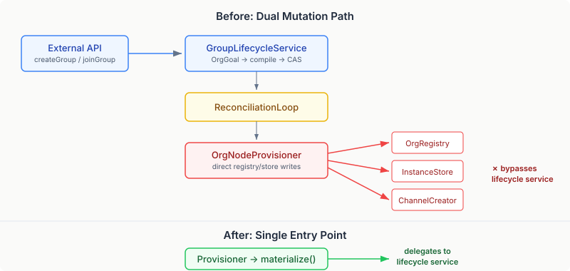
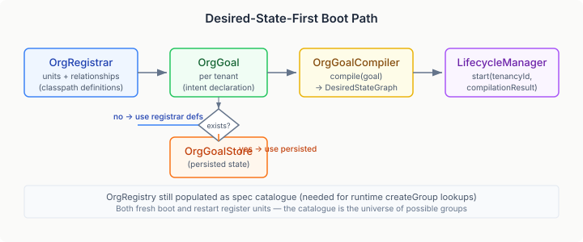
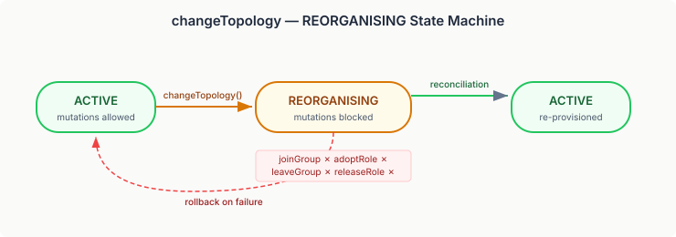

# Closing the Loop

Yesterday's entry proved a thesis: organisational structure is infrastructure, and the entire desired-state machinery — drift detection, fault escalation, plan approval, lifecycle state machines — applies to groups and roles and missions without modification. The bridge had five components, all implementing existing SPIs. No runtime changes were needed.

That last line was true and misleading. No *runtime* changes — but the bridge itself had a hole in it. The provisioner wrote directly to the registry, the instance store, and the channel creator. The boot path was imperative. The lifecycle service owned the desired-state mutations but not the physical ones. Two code paths did the same work, and neither knew about the other.

This is the kind of gap that doesn't break demos. It breaks production.

## 1. The Dual Mutation Path

The problem is visible in a dependency diagram.



When a user called `createGroup()`, the lifecycle service wrote an `OrgGoal`, compiled it via `OrgGoalCompiler`, CAS-swapped the desired-state graph into the reconciliation loop, and stored the goal. Clean. Correct. Single entry point.

When the reconciliation loop detected a new node and called `OrgNodeProvisioner.provision()`, the provisioner created a `GroupInstance`, registered the unit in `OrgRegistry`, and created a channel — all by reaching directly into the same stores the lifecycle service uses, but through a completely separate code path. No validation. No events. No locking.

This is the exact pattern that desired-state management is supposed to eliminate. The whole point of a reconciliation loop is that there's one path from intent to reality. Two paths means two places where bugs can hide, two paths that can diverge as the code evolves, and no guarantee that the invariants enforced by one are respected by the other.

## 2. The Fix: Materialise Through the Lifecycle Service

The provisioner should not know how to create a `GroupInstance`. It should not hold references to `OrgRegistry`, `GroupInstanceStore`, or `OrgChannelCreator`. It should delegate to the lifecycle service and let the service own the physical mutation — the same way it already owns the logical mutation.

The mechanism is package-private methods on `DesiredStateGroupLifecycleService`: `materializeUnit()`, `dematerializeUnit()`, `materializeRelationship()`, `dematerializeRelationship()`. These do exactly what the provisioner used to do — register, create instances, manage channels — but they live in the service, next to the validation and the locking and the event dispatch. The provisioner becomes a router: check the node type, delegate to the right method, return the result.

```java
@Override
public ProvisionResult provision(DesiredNode node, ProvisionContext context) {
    if (node.type().equals(OrgNodeTypes.UNIT)) {
        return lifecycleService.materializeUnit(node, context);
    } else if (node.type().equals(OrgNodeTypes.RELATIONSHIP)) {
        return lifecycleService.materializeRelationship(node, context);
    }
    return new ProvisionResult.Failed("unknown node type: " + node.type());
}
```

The provisioner shrank from 113 lines to 49. More importantly, it no longer imports `GroupInstanceStore`, `OrgRegistry`, or `OrgChannelCreator`. One dependency: the lifecycle service. One path through the system.

The same fix applied to `EmergencePromotionListener`. It was calling `registry.registerUnit(unit)` directly before calling `createGroup()` — bypassing the lifecycle service to pre-populate the catalogue. A new package-private method, `createGroupFromUnit()`, handles both steps. The listener dropped its `OrgRegistry` dependency entirely.

## 3. The Boot Path That Wasn't

`OrgBootstrap` ran at startup and did this:

```java
def.units().forEach(registry::registerUnit);
def.relationships().forEach(registry::addRelationship);
```

Imperative. No `OrgGoal`. No compilation. No reconciliation loop. The units existed in the registry but not in the desired-state graph. The first mutation via `GroupLifecycleService` would start the reconciliation loop, which would then discover units in the desired graph that had no corresponding `GroupInstance`, and provision them. But until that first mutation, the system was in an inconsistent state — units registered but not reconciled.



The new boot path builds an `OrgGoal` from `OrgRegistrar` definitions, groups by tenant, compiles each via `OrgGoalCompiler`, and starts the reconciliation loop through `LifecycleManager.start()`. On restart, persisted goals from `OrgGoalStore` take precedence over registrar definitions — the persisted goal has runtime mutations (members who joined, roles adopted, missions committed) that the static registrar definition doesn't.

The registry is still populated at boot — it's the spec catalogue, the universe of possible unit definitions that `createGroup()` can reference. But it's no longer the source of truth for what should exist. The `OrgGoal` is the source of truth. The reconciliation loop is the enforcement mechanism. The registry is a lookup table.

## 4. The Topology Problem

`changeTopology()` modifies the coordination topology of a running group — from `swarm` to `mesh`, or `hive` to `swarm`. In the original implementation, this was a field update: read the `OrgGoal`, replace the topology string, CAS the graph, done.

The problem is that topology changes are not atomic field updates. A group transitioning from swarm to mesh needs to reconfigure its coordination patterns, reassign roles, and potentially restructure its communication channels. During this transition, the group is in an intermediate state. If another mutation arrives — a member join, a role adoption — it's operating against a moving target.



The fix adds the `REORGANISING` intermediate state. When `changeTopology()` is called, the `GroupInstance` transitions from `ACTIVE` to `REORGANISING` before the goal mutation. While in `REORGANISING`, all other unit mutations — `joinGroup`, `leaveGroup`, `adoptRole`, `releaseRole`, `commitToMission`, `withdrawFromMission` — are rejected with an `OrgValidationException`.

The `DesiredStateOrgAdapter` maps `REORGANISING` to `NodeStatus.DRIFTED`, which triggers the reconciliation loop to re-provision the node. The provisioner's `materializeUnit()` sees a non-active instance, creates a new `ACTIVE` instance with the updated topology, and the group is back in service. If the goal mutation fails — CAS contention, validation error — the instance rolls back to `ACTIVE` immediately.

The blocking is explicit and visible. A client calling `joinGroup()` while a topology change is in flight gets a clear error, not a silent race condition. The rollback is automatic and tested. The intermediate state is real — it's in the instance store, it's visible to the adapter, it triggers reconciliation.

## 5. Per-Society Locking

The reconciliation loop provides CAS semantics for the desired-state graph. But CAS is tenant-scoped — the entire graph for a tenant is the unit of comparison. When two threads mutate different groups in the same tenant, they contend on the same CAS slot even though they're modifying independent state.

The fix is a per-group `ReentrantLock` keyed by `tenancyId:unitId`. Every mutation method — `createGroup`, `dissolveGroup`, `joinGroup`, `leaveGroup`, `adoptRole`, `releaseRole`, `changeTopology`, and the rest — acquires the lock for its target group before reading or writing. Mutations to different groups don't contend. Mutations to the same group are serialised.

The lock lives in a `ConcurrentHashMap` on the lifecycle service. It's created on first access and never evicted — the number of distinct groups is bounded by the domain, not by request volume. The `withUnitLock` helper handles both void and value-returning operations:

```java
private void withUnitLock(String unitId, String tenancyId, Runnable action) {
    var lock = unitLocks.computeIfAbsent(
        tenancyId + ":" + unitId, k -> new ReentrantLock());
    lock.lock();
    try { action.run(); } finally { lock.unlock(); }
}
```

This is not a replacement for CAS — it's a complement. The lock serialises mutations at the application level. CAS catches any remaining contention at the graph level. Together, they mean that concurrent mutations to the same group are serialised without retry, and concurrent mutations to different groups proceed without blocking each other.

## What This Means

The org bridge from yesterday was a proof of concept that worked. The changes today are what make it production-grade. The difference is not in capability — the bridge already managed groups through desired-state reconciliation. The difference is in the invariants it maintains:

**One path.** Every mutation — external API, reconciliation provisioner, emergence listener, boot — flows through the lifecycle service. There is no code path that writes to the stores directly. If a new feature adds validation, it applies everywhere. If a new event needs to fire, it fires on every path.

**Consistent boot.** The system starts in a reconciled state. The desired graph and the actual state are aligned from the first reconciliation cycle, not from the first user mutation.

**Safe topology changes.** Concurrent mutations to a reorganising group are rejected, not interleaved. The intermediate state is explicit, visible, and recoverable.

**Serialised mutations.** Two threads modifying the same group don't produce undefined behaviour. They take turns.

These are the properties that distinguish a working prototype from a system you can deploy. The reconciliation loop already knew how to converge. Now the code around it maintains the invariants that make convergence trustworthy.
