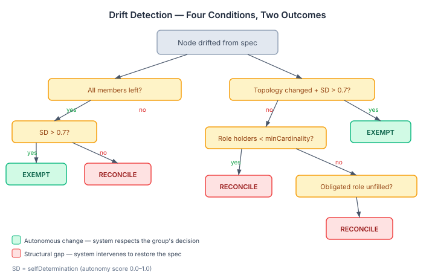
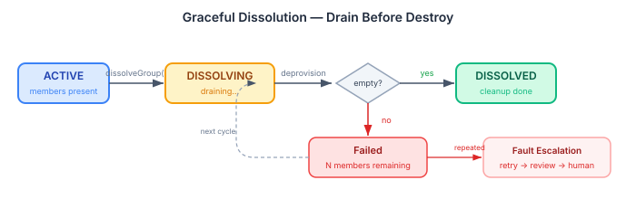
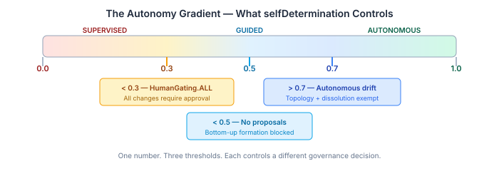

# Four Kinds of Wrong

A reconciliation loop that converges is table stakes. You declare a desired state, the system reads actual state, it plans the delta, it executes. The loop runs again. Everything converges. This is the infrastructure pattern that Kubernetes, Terraform, and every GitOps controller implements, and it works — for infrastructure.

Organisations are not infrastructure.

When a Kubernetes pod drifts from its spec, the answer is always the same: kill it and reschedule. The pod has no opinion. It has no autonomy. It didn't *choose* to diverge. But when a group of agents reorganises itself from a swarm into a mesh, or when every member of a team leaves voluntarily, the correct response is not to blindly reconstitute the original spec. The system needs to ask a different question: *should we fix this, or is this what the group intended?*

Until today, the eidos org bridge didn't ask that question. It had one drift detection path — autonomous topology change — and everything else fell through to the default: reconcile. Four conditions existed in the spec, but only one was implemented. The other three were invisible to the policy. The loop converged, but it converged without judgment.

## 1. Not All Drift Is the Same

The drift policy now evaluates four distinct conditions. Each one means something different to the system, and each one gets a different response.

**Natural dissolution.** Every member has left. The `GroupInstance` has an empty members list. If the group's `selfDetermination` is above 0.7, this is an autonomous decision — the group chose to dissolve. The system exempts it from reconciliation. If autonomy is low, the group wasn't empowered to make that call, and the system intervenes to restore it.

**Autonomous topology change.** The group's actual topology doesn't match its declared topology, and the group has enough autonomy to have made that change deliberately. Already implemented — this was the only path that existed before.

**Member departure below `minCardinality`.** A `RoleSpec` declares that at least N agents must hold a given role. Actual `RoleAdoption` count for that role has dropped below the minimum. This is always a structural gap — the group can't function as designed. The system reconciles regardless of autonomy.

**Role gap with unfulfilled obligations.** A `RoleSpec` carries obligations — things that must be done — but no agent has adopted the role. The obligation is unmet. Again, always reconcile. Autonomy doesn't excuse structural incompleteness when obligations are at stake.

The distinction matters because it encodes a theory of organisational governance. Structural violations — missing roles, insufficient headcount — are failures that need repair. Autonomous choices — a group reorganising itself, a group choosing to disband — are legitimate expressions of agency that the system should respect. The same reconciliation loop handles both, but the drift policy mediates between them.

## 2. Dissolution Is Not Deletion

The previous `dissolveGroup()` implementation removed the unit from the desired-state graph and let the reconciliation loop clean up. Immediate. No intermediate state. The group went from ACTIVE to DISSOLVED in one cycle, regardless of whether work was in progress, roles were filled, or members were mid-task.

This is the infrastructure pattern again. You remove a pod from the desired state, the controller kills it, done. But a group with active members, unfulfilled obligations, and in-flight work can't be killed cleanly. It needs to drain.

The fix adds a `DISSOLVING` intermediate state. When `dissolveGroup()` is called, the `GroupInstance` transitions to DISSOLVING before the unit is removed from the `OrgGoal`. The reconciliation loop detects the orphaned node and plans a deprovision. But `dematerializeUnit()` now gates on member drain — if members are still present, it returns `DeprovisionResult.Failed` with a count of remaining members.

The reconciliation loop's existing fault escalation handles the rest. First failure: retry next cycle. Repeated failures: fault count increases. Threshold crossed: review node created. The drain doesn't need its own timeout mechanism — the fault policy *is* the timeout mechanism. If a group can't drain naturally, the system escalates to human review through exactly the same path it uses for any other persistent failure.

The adapter maps DISSOLVING to `NodeStatus.DRIFTED` rather than ABSENT. A dissolving group is still a live entity in an intermediate state — it has members, it may have active work. Mapping it to ABSENT would make it invisible to the reconciliation loop, which is the opposite of what we want. DRIFTED means the system sees it, plans for it, and acts on it.

## 3. The Autonomy Gradient

`selfDetermination` is a single number between 0.0 and 1.0. It's been in the `OrganizationalUnit` model from the beginning, and it already controlled two decisions: the `OrgGoalCompiler` gates nodes with `selfDetermination < 0.3` behind `HumanGating.ALL`, and the `OrgPlanApprovalPolicy` requires plan approval below the same threshold. The drift policy uses 0.7 as its exemption threshold for topology changes and dissolution.

What was missing was the middle of the gradient. Bottom-up proposals — a group forming itself from below, not being created top-down — had no autonomy check at all. A group with `selfDetermination` of 0.1 could self-organise. And topology changes had no gate — the drift policy would exempt autonomous topology changes above 0.7, but `changeTopology()` itself would accept the mutation at any autonomy level.

The fix adds two checks. `proposeGroup()` now requires `selfDetermination >= 0.5` for bottom-up proposals — a group that doesn't have sufficient autonomy doesn't get to form itself. `changeTopology()` requires `selfDetermination > 0.7` — the same threshold the drift policy uses to exempt autonomous topology changes. This is deliberate symmetry: if the system would reconcile a topology change at a given autonomy level, it shouldn't allow the change in the first place.

The three thresholds — 0.3, 0.5, 0.7 — aren't arbitrary. They encode a governance model:

- **Below 0.3:** Fully supervised. All changes require human approval. The group exists, but it doesn't make decisions.
- **0.3 to 0.5:** Partially autonomous. Normal operations proceed, but the group can't self-organise or restructure.
- **0.5 to 0.7:** Self-organising. The group can form bottom-up and operate independently, but structural changes (topology) still need higher autonomy.
- **Above 0.7:** Fully autonomous. Topology changes are permitted and respected. Dissolution is treated as a legitimate group decision.

One field. Three thresholds. Four governance zones. The same field that controls drift policy controls formation gates controls topology gates. No separate permission model. No access control lists. Just a continuous measure of how much the system trusts the group to manage itself.

## What This Opens Up

The organisational reconciliation bridge now has behavioral intelligence — not just convergence mechanics. It distinguishes between drift that needs repair and drift that represents intentional change. It dissolves groups gracefully instead of killing them. It enforces autonomy thresholds consistently across formation, mutation, and reconciliation.

These are the same governance problems that human organisations solve with approval chains, notice periods, and delegation of authority. The desired-state runtime solves them with the same primitives it uses for infrastructure — drift policies, fault escalation, lifecycle states — but applied to a domain where the managed entities have agency.

The runtime doesn't know it's managing organisations. It sees nodes, specs, drift conditions, and fault events. The intelligence is in the policy layer — the drift policy that distinguishes four conditions, the approval policy that reads autonomy levels, the dissolution gate that checks for members. Domain knowledge expressed through SPIs, evaluated by a domain-agnostic engine. The same engine that manages pods and pipelines, managing teams and roles and missions.
