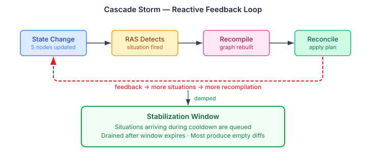

# When the Org Chart Learns to Wait

The [previous entry](2026-11-06-mdp01-the-crud-wrapper-that-bypassed-its-own-loop.md) covered the D9 fix — the structural shift from CRUD to desired-state-first. With that foundation in place, the remaining hardening work exposed a different class of problems: not "the loop isn't running" but "the loop runs too eagerly."

## The Cascade Storm Problem

A desired-state reconciliation loop is reactive. State changes produce events. RAS (the Runtime Anomaly Service) aggregates events into situations. Situations trigger recompilation — the graph gets rebuilt based on what went wrong. The new graph drives reconciliation, which produces more state changes, which produce more events.

This is a feedback loop, and without damping it oscillates.

Consider an agent society restructuring. A situation fires — say, coordination storm among five agents. The `SituationRecompilerEngine` evaluates it and recompiles the graph: reorganise the group from a flat swarm to a supervised hive with a coordinator role. The reconciliation loop applies this. Five nodes get updated. Each update produces state-change events. RAS sees five new signals and fires another situation. The recompiler evaluates again. The graph was just recompiled, so the diff is empty — but the evaluation still runs. Meanwhile a second situation fires from the same cluster of events. And a third.

In a ten-agent society with three active groups, a single restructuring can trigger dozens of situation evaluations within the stabilization period. Most produce empty diffs. All consume compute. Some hit timing windows where the previous recompilation hasn't fully reconciled yet, producing genuine but spurious drift signals.



The fix is not to filter situations or debounce events. The runtime already debounces reconciliation cycles. The problem is one level up: the recompilation path has no cooldown. Every situation, regardless of timing, goes straight to the recompiler chain.

## The Stabilization Window

The solution is a per-tenant cooldown inside `SituationRecompilerEngine`. After a successful recompilation, the engine starts a timer. Situations arriving during the window are queued, not evaluated. When the window expires, the queue drains — each queued situation is evaluated against fresh state. Most produce empty diffs because the recompilation that triggered the window already addressed the underlying problem.

```java
public sealed interface QueuedSituation {
    String tenancyId();

    record Recompile(String tenancyId, ActiveSituation situation,
                     DesiredStateGraphFactory factory) implements QueuedSituation {}
    record Resolved(String tenancyId, String situationId,
                    DesiredStateGraphFactory factory) implements QueuedSituation {}
}
```

Two things about the design are worth noting.

First, the queued situations carry only identity — the `ActiveSituation` and tenant ID, not graph or actual-state snapshots. The drain reads fresh state at evaluation time. A snapshot taken at queuing time would be stale — the whole point of the window is to let the previous recompilation settle before evaluating what's next.

Second, the window lives in the engine, not in the dispatch layer. `SituationRecompilerEngine` sits below both entry points — the CDI event path (`SituationRecompilerDispatchCore`) and the engine workflow path (`DesiredStateReplanDispatch`). Putting the gate here means both paths are covered without duplication.

The drain itself is a callback. The engine doesn't have access to `ReconciliationLoop` or `ActualStateAdapterRouter` — it's a pure POJO in runtime-core, framework-neutral by design. So it defines a `DrainHandler` functional interface, and the dispatch core implements it:

```java
@FunctionalInterface
public interface DrainHandler {
    void drain(String tenancyId, List<QueuedSituation> queued);
}
```

The dispatch core's implementation reads fresh graph and actual state per queued situation, then calls back into the engine's `recompile()` or `situationResolved()`. If a queued situation produces a new recompilation during the drain, the engine starts a new window — the remaining queued situations get re-queued. The drain can't cascade because each restart is timer-scheduled, not inline.

The default window is five minutes, configurable via `DesiredStatePreferenceKeys.STABILIZATION_WINDOW`. Set to `Duration.ZERO` to disable. On restart, the in-memory window state is lost — this is safe because the desired graph already reflects the last recompilation. An early-firing situation after restart produces a diff against the already-recompiled graph: a no-op transition plan.

## Drift That Was Always There

With the desired-state-first pattern working, `OrgDriftPolicy` could finally detect the drifts that matter for a living organisation.

A member departure is drift. When an agent leaves a group, the desired graph still lists them as a member. The adapter reads the actual `GroupInstance` and finds them missing. The reconciliation loop sees the gap and the provisioner can re-fill the slot or escalate.

A role gap is drift. If a required role goes unfilled — the coordinator left and nobody adopted the role — the adapter sees the discrepancy. The same loop. The same escalation. No special-case notification code.

But here's where organisations differ from infrastructure. A group with high `selfDetermination` — above 0.7 — is expected to handle these situations itself. A member departure in a self-governing swarm might be intentional. The drift policy exempts it. A member departure in a supervised group with low `selfDetermination` gets corrected. One value governs the response.

## The Lifecycle State Map

A subtler problem: `DesiredStateOrgAdapter` was mapping `FORMING` and `DISSOLVING` groups to `NodeStatus.ABSENT`. Both are wrong.

A group in `FORMING` state has been provisioned — the provisioner returned success, the group is going through its initial lifecycle. Mapping it to `ABSENT` tells the reconciliation loop "this node doesn't exist" and triggers re-provisioning. The group gets created twice.

A group in `DISSOLVING` state still exists — it's draining members, cleaning up channels, running its dissolution lifecycle. Mapping it to `ABSENT` tells the loop the group is already gone, which either skips necessary cleanup or produces confusing plan diffs.

Both now map to `PRESENT`. The group exists. The reconciliation loop leaves it alone. When dissolution completes and the state transitions to `DISSOLVED`, the adapter maps to `ABSENT` — which is when deprovisioning should happen.

## Formation Shortcuts

The final piece: `createGroup` was returning `GroupLifecycleState.PROPOSED` for every formation origin. A top-down group — one created by an operator — had to go through `createGroup` → `approveProposal` → `activateGroup`. Three calls for a path that needs no approval.

`PROPOSED` exists for bottom-up proposals. An agent observes that a team would be useful and proposes it. The proposal sits in `PROPOSED` state until a human or policy approves it. The `PlanApprovalPolicy` enforces this — groups with `selfDetermination` below 0.3 require explicit approval.

But an operator calling `createGroup` with `FormationOrigin.TOP_DOWN` is the approval. They're the authority. Making them go through a proposal-approval-activation ceremony is bureaucracy, not governance. Same for `EMERGENCE` — when the runtime's own team detector identifies a stable collaboration pattern and promotes it, the detection IS the justification.

The fix: `createGroup` now returns `ACTIVE` for `TOP_DOWN` and `EMERGENCE` origins, `PROPOSED` only for `PROPOSAL`. One conditional. The group enters the reconciliation loop immediately.

## What Fifteen Issues Taught

The society hardening epic started as a list of missing features. It turned into something more specific: the gap between a working bridge and a production-grade one. The bridge handled the happy path from day one. What it didn't handle was the system's reaction to its own actions — cascade storms from the feedback loop, lifecycle states that confused the reconciliation planner, ceremony where none was needed.

Every fix made the system quieter. The stabilization window stops the recompiler from arguing with itself. The lifecycle state map stops the planner from re-provisioning groups that already exist. The formation shortcut stops the operator from performing ceremonies for decisions already made.

The desired-state pattern works best when the loop can be trusted to converge without interference. These fixes remove the interference.
